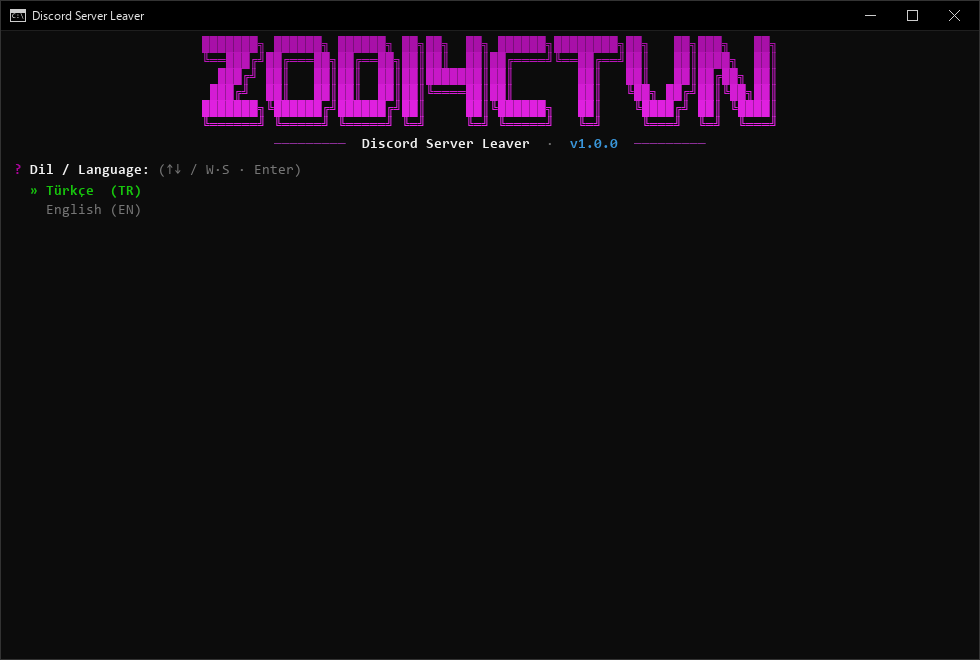

# Discord Server Leaver

<div align="center">


```
███████╗ ██████╗ ██████╗ ██╗██╗  ██╗ ██████╗████████╗██╗   ██╗███╗   ██╗
╚══███╔╝██╔═══██╗██╔══██╗██║██║  ██║██╔════╝╚══██╔══╝██║   ██║████╗  ██║
  ███╔╝ ██║   ██║██║  ██║██║███████║██║        ██║   ██║   ██║██╔██╗ ██║
 ███╔╝  ██║   ██║██║  ██║██║╚════██║██║        ██║   ╚██╗ ██╔╝██║╚██╗██║
███████╗╚██████╔╝██████╔╝██║     ██║╚██████╗   ██║    ╚████╔╝ ██║ ╚████║
╚══════╝ ╚═════╝ ╚═════╝ ╚═╝     ╚═╝ ╚═════╝   ╚═╝     ╚═══╝  ╚═╝  ╚═══╝
```

**Bulk leave Discord servers safely — interactive CLI tool**

[](LICENSE)
[](https://python.org)
[](https://docs.astral.sh/ruff/)
[](https://github.com/zodi4ctvn)

<br>



</div>

---

## 🇹🇷 Türkçe

### Nedir?

Discord Server Leaver, birden fazla Discord sunucusundan tek seferde toplu ayrılmanı sağlayan güvenli, interaktif bir komut satırı aracıdır. Token asla diske yazılmaz — oturum sona erdiğinde `secure_wipe()` ile bellekten silinir.

### Özellikler

- 🔒 **Sıfır depolama** — Token hiçbir dosyaya, log'a veya geçmişe yazılmaz; çıkışta ve geri dönüşte bellekten silinir, panoda kaldıysa isteğe bağlı pano temizleme sorar
- 🌐 **Türkçe & İngilizce arayüz** — Başlangıçta dil seçimi (sistem dilini otomatik tanır)
- 🖱️ **Tek tıkla çalıştırma (`start.bat` / `.exe`)** — Windows'ta ilk açılışta sanal ortamı ve bağımlılıkları otomatik kurar, CMD ile uğraştırmaz
- 👑 **Yetki etiketleri & `U` filtresi** — Sahip olduğun (`[SAHİBİ]`, kilitli), Yönetici olduğun (`[YÖNETİCİ]`) ve yetkili olduğun (`[YETKİLİ]`) sunucuları gösterir; tek tuşla (`U`) sadece yetkisiz sunucuları seçebilirsin
- ☑️ **İki panelli sunucu seçici** — Solda A-Z sunucu listesi, sağda anlık arama (`/`) ve seçim özeti
- ⌨️ **Tam klavye & geri gitme desteği** — Ok tuşları yoksa `W / S` (ve `J / K`) ile gezin; `Backspace` / `Esc` ile her adımda bir önceki ekrana temizce dön
- 📋 **Kolay yapıştırma** — Yıldızlı (`*****`) token ekranında doğrudan `Ctrl+V` veya sağ tık ile yapıştır
- ✅ **Onay ekranı** — Ayrılacağın sunucuları (varsa yönetici/yetkili uyarılarıyla) ve tahmini süreyi gör, `CONFIRM` yazarak onayla
- 🛡️ **3 katmanlı akıllı rate limit** — Discord `X-RateLimit-*` başlıklarına uyum, `os.urandom` tabanlı insan benzeri gecikmeler (`0.8–2.0 sn`, her 10 çıkışta `4–7 sn` mola), 429 üstel geri çekilme ve 5xx otomatik yeniden deneme
- 🎮 **Discord istemci algılama** — Kurulu Discord Stable / Canary / PTB istemcilerini otomatik algılar
- 📊 **Titremesiz canlı ilerleme** — Ayrılan her sunucu kalıcı olarak listelenir (hiçbiri gizlenmez), altta tek satırlık ilerleme çubuğu ve sonunda özet paneli gösterilir

### Kurulum ve Kullanım

#### Windows — Hazır `.exe` (Python gerekmez)

1. [Releases](https://github.com/zodi4ctvn/discord-server-leaver/releases) sayfasından **`DiscordServerLeaver.exe`** dosyasını indir ve çift tıkla.
2. > **Antivirüs Notu:** `.exe` dosyası PyInstaller (`--onefile`) ile paketlendiği ve ücretli kod imzalama sertifikası içermediği için bazı antivirüsler (`Wacapew.C!ml` gibi) yanlış pozitif (false positive) uyarısı verebilir. Kaynak kodu kendiniz inceleyip aşağıdan `start.bat` ile de çalıştırabilirsiniz.

#### Windows — Kaynak koddan (tek tık)

1. [Python 3.11+](https://www.python.org/downloads/) kurulu olsun.
2. Repoyu indir ve klasördeki **`start.bat`** dosyasına çift tıkla.
3. İlk açılışta `.venv` ve paketler otomatik kurulur, ardından araç doğrudan açılır.

#### Terminal / CLI (Windows, Linux, macOS)

```bash
git clone https://github.com/zodi4ctvn/discord-server-leaver
cd discord-server-leaver
pip install -e .
dsl
```

### Kısayollar

| Tuş | İşlev |
| --- | --- |
| `↑` / `↓` veya `W` / `S` | Menülerde ve sunucu listesinde gezin |
| `Space` | Sunucuyu seç / seçimi kaldır |
| `A` / `N` | Görünenlerin hepsini seç / temizle |
| `U` | Sadece yetkisiz (normal üye) sunucuları seç — Sahip/Yönetici/Yetkili korunur |
| `/` veya `Tab` | Canlı arama kutusuna geç |
| `Backspace` / `Esc` | Önceki adıma geri dön |
| `Ctrl+V` | Token ekranında panodan yapıştır |
| `Enter` | Onayla / devam et |
| `Ctrl+C` | Güvenli çıkış (token bellekten silinir) |

### Güvenlik

- Token asla `.env`, log dosyası veya herhangi bir yapılandırma dosyasına yazılmaz
- Yalnızca 3 Discord REST endpoint'ine ham `httpx` (HTTP/2) ile bağlanır (`GET /users/@me`, `GET /users/@me/guilds`, `DELETE /users/@me/guilds/{id}`)
- Telemetri, analitik veya `discord.com` dışında hiçbir ağ bağlantısı yoktur
- Her oturumda taze bir `X-Super-Properties` parmak izi üretilir
- Sahibi olduğun sunucular otomatik kilitlenir ve atlanır

### Uyarı

Bu araç yalnızca kendi kullanıcı hesabın için tasarlanmıştır; bot token'ı ile çalışmaz. Discord Kullanım Şartları'na uygun kullanım kullanıcının sorumluluğundadır.

---

## 🇬🇧 English

### What is it?

Discord Server Leaver is a secure, interactive command-line tool that lets you bulk-leave Discord servers safely. Your token is never written to disk — it is overwritten in memory via `secure_wipe()` when the session ends.

### Features

- 🔒 **Zero persistence** — Token is never saved to any file, log, or history; wiped from memory on exit or back navigation, with optional clipboard cleanup
- 🌐 **Turkish & English UI** — Language selector on startup (auto-detects your OS locale)
- 🖱️ **One-click Windows launcher (`start.bat` / `.exe`)** — Automatically creates `.venv` and installs dependencies on first run
- 👑 **Permission badges & `U` filter** — Highlights servers you own (`[OWNER]`, locked), administer (`[ADMIN]`), or moderate (`[MOD]`); press `U` to select regular servers only while protecting privileged ones
- ☑️ **Two-panel server picker** — A-Z server list on the left, live search (`/`) and selection preview on the right
- ⌨️ **Full keyboard & back navigation** — Supports `↑↓`, `W / S`, and `J / K` (great for 60% keyboards), plus `Backspace` / `Esc` to step back cleanly at any screen
- 📋 **Masked `Ctrl+V` paste** — Password-masked (`*****`) token prompt with direct Windows clipboard `Ctrl+V` support
- ✅ **Confirmation screen** — Review selected servers (including `[ADMIN]` / `[MOD]` warnings) and estimated time, then type `CONFIRM`
- 🛡️ **3-layer rate limiting** — Honors Discord `X-RateLimit-*` headers, `os.urandom`-seeded human-like delays (`0.8–2.0s`, `4–7s` rest every 10 leaves), 429 exponential backoff, and 5xx retries
- 🎮 **Client detection** — Auto-detects installed Discord Stable, Canary, and PTB clients
- 📊 **Flicker-free progress log** — Permanently prints every processed server above a single-line live progress bar (nothing gets hidden), followed by a summary panel

### Installation & Usage

#### Windows — Standalone `.exe` (No Python required)

1. Download **`DiscordServerLeaver.exe`** from [Releases](https://github.com/zodi4ctvn/discord-server-leaver/releases) and double-click.
2. > **Antivirus Note:** Because the `.exe` is packaged with PyInstaller (`--onefile`) without a paid code-signing certificate, a few heuristic scanners (e.g. `Wacapew.C!ml`) may report a false positive. You can always inspect the source code and run it directly via `start.bat` below.

#### Windows — From source (One-click)

1. Make sure [Python 3.11+](https://www.python.org/downloads/) is installed.
2. Clone or download the repository and double-click **`start.bat`**.
3. On first launch it sets up `.venv` and installs dependencies automatically.

#### Terminal / CLI (Windows, Linux, macOS)

```bash
git clone https://github.com/zodi4ctvn/discord-server-leaver
cd discord-server-leaver
pip install -e .
dsl
```

### Keyboard Shortcuts

| Key | Action |
| --- | --- |
| `↑` / `↓` or `W` / `S` | Navigate menus & server list |
| `Space` | Toggle server selection |
| `A` / `N` | Select all / clear visible servers |
| `U` | Select regular servers only — automatically protects Owner/Admin/Mod servers |
| `/` or `Tab` | Focus live search |
| `Backspace` / `Esc` | Go back to the previous step |
| `Ctrl+V` | Paste from clipboard in token prompt |
| `Enter` | Confirm / continue |
| `Ctrl+C` | Graceful exit (wipes token from memory) |

### Security

- Token is never persisted to `.env`, logs, or disk
- Raw `httpx` (HTTP/2) calls to only 3 Discord endpoints (`GET /users/@me`, `GET /users/@me/guilds`, `DELETE /users/@me/guilds/{id}`)
- Zero telemetry, zero analytics, zero network calls outside `discord.com`
- Fresh `X-Super-Properties` fingerprint generated per session
- Owned servers are locked and automatically skipped

### Disclaimer

This tool is intended for your own user account only and does not support bot tokens. Compliance with Discord's Terms of Service is the user's responsibility.

---

## Project Structure

```
discord-server-leaver/
├── src/
│   └── leaver/
│       ├── __init__.py      # Version & author metadata
│       ├── main.py          # CLI entry point & step navigation
│       ├── api.py           # Discord REST API layer (httpx HTTP/2)
│       ├── ui.py            # Rich + prompt_toolkit / Questionary TUI
│       ├── i18n.py          # Turkish & English localization
│       ├── security.py      # Masked token input, secure_wipe, fingerprint, Layer-1 limiter
│       └── utils.py         # Adaptive delays, backoff, logging helpers
├── assets/
│   ├── logo.png             # Discord-Z application logo
│   ├── icon.ico             # Multi-resolution Windows .exe icon
│   ├── demo.gif             # Animated CLI walkthrough
│   └── preview.png          # Two-panel server selector screenshot
├── start.bat                # One-click Windows launcher (auto-setup)
├── pyproject.toml           # Hatchling build config, dependencies, Ruff & Mypy
├── README.md
├── LICENSE                  # MIT — zodi4ctvn
└── .gitignore
```

---

## Development

```bash
pip install -e ".[dev]"
ruff check src
ruff format --check src
mypy src
```

---

<div align="center">
Made by <a href="https://github.com/zodi4ctvn">zodi4ctvn</a> · MIT License
</div>
